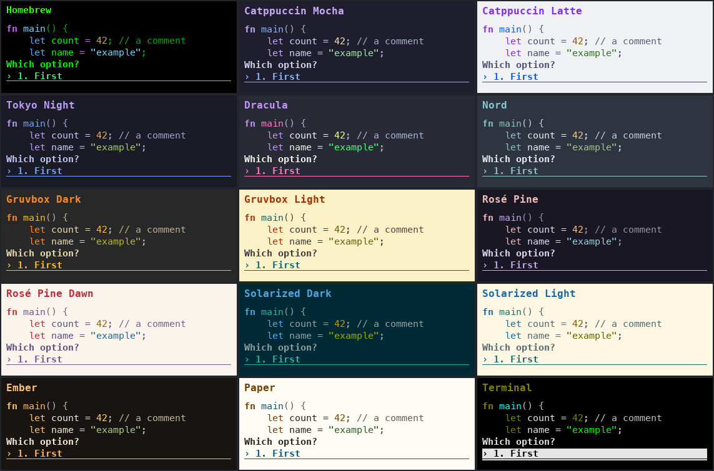

# Themes

Talaria follows the profile's Hermes skin by default. The automatic appearance uses the
detected light or dark palette for panels, selections and status. When Talaria cannot
determine the terminal's background, it uses the terminal's named colours. Inline chat
keeps the terminal background. A theme file can override each role or individual element.

Open `/theme` or choose **Settings → Appearance** from the top menu to preview themes.
Press Enter to save a theme for future sessions on the same profile. To give all
profiles a default, set it in `~/.talaria/config.toml`.

```toml
[theme]
file = "homebrew"
```

## Built-in themes

Try `/theme use homebrew` to switch immediately. To compare looks, open `/theme`, move
with the arrow keys, and watch the sample and composer. Escape cancels the preview.
Choose **Configured** to return to the theme from your configuration.



| Family | Identifiers | What to expect |
| --- | --- | --- |
| Homebrew | `homebrew` | Pure green on black with a darker green composer border. Provider headings and tool names are cyan, inline code is blue, warnings are gold, and focused answers are mint. The model and effort are deep purple. Markdown emphasis and shell operators are bright purple. |
| Catppuccin | `catppuccin-mocha`, `catppuccin-latte` | Pastel lavender on a dark plum canvas, or mauve and blue on a light canvas. [Palette](https://catppuccin.com/palette/) |
| Tokyo Night | `tokyo-night` | Midnight blue with blue and violet accents. [Tokyo Night](https://github.com/folke/tokyonight.nvim) |
| Dracula | `dracula` | Charcoal with violet, pink and bright green. [Dracula specification](https://draculatheme.com/contribute) |
| Nord | `nord` | Slate with frost blue and teal. [Nord palette](https://www.nordtheme.com/docs/colors-and-palettes) |
| Gruvbox | `gruvbox-dark`, `gruvbox-light` | Earth tones on warm charcoal or cream. [Gruvbox](https://github.com/morhetz/gruvbox) |
| Rosé Pine | `rose-pine`, `rose-pine-dawn` | Rose and iris on dark plum or pale cream. [Rosé Pine palette](https://rosepinetheme.com/palette/) |
| Solarized | `solarized-dark`, `solarized-light` | Blue and cyan on deep teal or warm ivory. [Solarized palette](https://ethanschoonover.com/solarized/) |
| Talaria originals | `ember`, `paper` | Warm amber on brown, or blue and brown on off-white. |
| Terminal | `terminal` | Uses the terminal's own colours and follows the profile's Hermes skin setting. |

The fixed palettes use their own colours independently of Hermes skins. For a custom
variation, copy a file from [the built-in theme directory](../crates/talaria-app/themes)
into `~/.talaria/themes/` under a new name. Each file is a complete, editable starting
point. A user file with the same identifier as a new community theme takes precedence.

In `/effort`, Homebrew uses purple for the selected level and lavender for the model name.
To adjust the selector in a custom theme, set the foreground (`fg`) of `effort.selected`
for the diamond and level, `effort.track` for the filled line, or `effort.model` for the model name.

The [theme review](theme-review.md) records checks on terminal screens and the weakest
measured colour pair for each palette.

## Theme files

Create the folder with `mkdir -p ~/.talaria/themes`. Save a UTF-8 TOML file as
`~/.talaria/themes/<id>.toml`. Files are shared
across profiles. The identifier starts with a lower-case letter or digit, followed by up to
63 lower-case letters, digits, underscores or dashes. Files cannot leave that folder, including
through symbolic links, and cannot exceed 256 KiB. The identifiers `terminal`, `dark`, `light`,
`ember` and `paper` are reserved for built-ins and cannot name user files.

For example, save the following as `~/.talaria/themes/quiet-amber.toml` to change the
accent and the active composer frame.

```toml
schema = 1
name = "Quiet amber"
extends = "dark"
follow_hermes_skin = true

[palette]
accent = "#ffb86b"

[elements."composer.border.focused"]
fg = "$palette.accent"
bold = true
```

Run `/theme use quiet-amber` to try it. Edit the file and run `/theme reload` to see
changes while the session is open. Set `file = "quiet-amber"` under `[theme]` in
`~/.talaria/config.toml` to select it at launch. A
`[theme.profiles."fixture"]` table with `file = "quiet-amber"` selects it for that profile.
Talaria first tries the profile's saved choice, then its configured theme, then the global
`[theme] file`. With no selection, it follows the existing Hermes skin behaviour.
Talaria stores confirmed choices in `~/.talaria/theme-selection.json`. Run `/theme use`
to clear the saved file choice for this profile.
/theme new <id> writes themes/<id>.toml beside config.toml and does not select the theme.

`schema = 1` is required. `extends` defaults to `terminal` and accepts only `terminal`, `dark`
or `light`, never another file or a URL. `name` is an optional display label. The twelve palette
slots are `background`, `surface`, `foreground`, `muted`, `disabled`, `border`, `primary`,
`accent`, `success`, `warning`, `error` and `attention`. Fourteen style roles use these colours:
`background`, `surface`, `text`, `muted`, `disabled`, `border`, `primary`, `accent`, `success`,
`warning`, `error`, `attention`, `selection` and `focus`.

A role table such as `[roles.accent]`, or an element table such as
`[elements."transcript.heading.1"]`, accepts `fg`, `bg`, `underline_color`, and the booleans
`bold`, `dim`, `italic`, `underline`, `reverse` and `strikethrough`. Omission inherits the field;
`false` clears an inherited attribute. Colours accept `"default"`, `"#RRGGBB"`, `"ansi:0"`
through `"ansi:15"`, and `"index:0"` through `"index:255"`. Roles and elements may reference
`"$palette.<slot>"`. Palette values are literal colours; references cannot chain. Unknown keys,
tokens, roles, slots, colour forms and values reject the whole file with the key, line and column.
There are no expressions, wildcards, scripts, environment substitutions or blinking attributes.

The [element catalogue](theme-tokens.md) lists the element names and their defaults. A selected file
styles the transcript, syntax highlighting, status, composer, tools, work panel, menus, pickers
and overlays. Settings, configuration, memory, model roles and the gateway health check share
the `list.*` and `dialog.*` styles. Element overrides can change one part of a view without
changing its role peers.

If `status.model` is omitted, the conversation model and effort use the status accent.
If `tool.shell.operator` is omitted, shell operators use the tool subject style.

The layers, from lowest to highest, are the built-in base, the eligible Hermes skin, the file's
palette, its roles, its element fields, and the terminal's rendering constraints. An authored
role or palette slot wins over skin values for its bound elements. Unrelated skin distinctions
remain. `follow_hermes_skin = false` in the file disables the bridge. The existing configuration
permission and colour-depth exclusions also apply.

`[chrome] border` accepts `rounded`, `single`, `double`, `ascii` or `none` and changes the
frames throughout Talaria. `none` replaces frame glyphs with spaces while preserving their
width. The active composer frame uses `composer.border.focused`. `section_divider` accepts
`single`, `double`, `ascii` or `none` for Talaria's section separators. Markdown rules and table
grids remain content and keep their glyphs. Themes never change motion, dimensions, keys or
action meanings.

The inline view normally uses the terminal's background and default body text colour. Without a
theme file, scheduled-job and workflow selections retain their existing dark grey backgrounds.
With a file selected, full-screen overlays and the workspace paint their whole owned area:
transcript, composer, status, tools, diffs and workspace use `background`; menus, work panels,
dialogs, pickers and alternate lists use `surface`. Inline surfaces omit backgrounds, including
selection backgrounds, so native scrollback keeps the terminal's background. Inline command,
appearance, mention, question and reasoning-effort selections underline the highlighted text.
They use the selection fill as ink when it reads clearly on the theme canvas, or the
selection foreground when that gives better contrast. The Terminal theme asks the
emulator to invert its own colours behind the current choice. A custom theme can do
the same by setting both selection colours to `"default"` and `reverse = true`.
When a selected light theme is used on a dark terminal, or the reverse, the live composer
and appearance preview paint the theme's own background. Finished lines keep the native
scrollback background and use the terminal's text colour where a themed foreground would
have less than 4.5:1 contrast with it.
The contrast diagnostic uses a trusted startup background for inline text when available; otherwise it
reports the pair as unknown. Selection/focus pairs are measured against their paired
backgrounds. The diagnostic warns below 4.5:1 for text and 3:1
for structural marks, names the affected tokens, and never rewrites an authored colour. ANSI
palette colours and unknown terminal defaults cannot be measured reliably. True-colour terminals
use the authored colours. At 256 colours Talaria chooses the nearest indexed colour. At 16
colours it prefers the nearest conventional swatch that preserves the contrast of a readable
foreground and background. Terminal uses named colours according to the detected light or
dark background and uses reverse video for selection. A non-empty `NO_COLOR` or
`[theme] colors = "none"` removes all
foreground, background and underline colours while retaining attributes.

An invalid startup file gives one notice and uses the existing appearance. `/theme reload`
rereads the selected file manually; an invalid reload retains the last good theme. There is no
file watcher. New cells and chrome use a successful change. Streaming cells finish in their
starting theme, and finished native scrollback keeps its colours.

## Where the skin comes from

- At launch, from the `skin` of the `runtime.describe` result, which Hermes resolves for this
  connection's profile. The skin is applied before any history is written.
- Live, from `skin.changed` events (another window ran `/skin`, or the skin file changed). A
  replayed `skin.changed` after a reconnect is ignored; Talaria calls `runtime.describe` again
  after every reconnect instead, retrying once after a second if that call fails.
- A skin equal to the current one draws nothing. `{}` or no skin means Talaria's own colours.

A change recolours the composer, the status line, tool rows and cells that start after it. Lines already
in the terminal's scrollback keep their colours, and a reply that is streaming when the skin
changes finishes in the colours it started with.

## Light, dark and colour depth

Light or dark follows this order: `TALARIA_THEME`, the profile's saved light or dark
background, `[theme] mode`, the terminal's background colour (not when it reports
exactly black, which some terminals and tmux do when they do not know), its text colour,
`COLORFGBG`, `TERM_PROGRAM=Apple_Terminal`, then dark.

Colour depth: a non-empty `NO_COLOR` turns colour off, then `[theme] colors`, then `TERM=dumb`
(off), `COLORTERM` (`truecolor` or `24bit`), `TERM` containing `256color`, then 16 colours. On a
16-colour terminal, with `follow_hermes_skin = false`, or with colour off, the skin is not applied.
Colour off keeps bold, italic and underline.

On the default skin path, body text keeps the terminal's own colour and skin colours that are
too faint for the background are lifted to a readable contrast as in Hermes's terminal interface.
Theme files preserve their authored colour pairs on owned surfaces and report contrast warnings.
Native scrollback uses the terminal's background.

## Commands

- `/skin` shows the profile's skin and how Hermes resolved it, then opens a selector under the
  composer that lists Hermes's skins with their descriptions and marks the current one. Typing
  filters the list, Up and Down move, Enter keeps the selected skin as `/skin <name>` does, and
  Esc closes the list. Hermes cannot show a skin without making it the profile's skin, so once
  the selection rests for about 300 ms Talaria sets it for the profile to preview it; Esc, or
  quitting while the list is open, sets the original skin again. A switch to another session or
  profile closes the list first and starts once the original skin is set again. Other Hermes
  windows on the profile change with each preview.
- `/skin <name>` sets the profile's Hermes skin (`display.skin`), as Hermes's own `/skin` does,
  so other Hermes windows on the profile change too.
- `/theme report` shows the skin, the background, the colour depth and the motion setting, each with
  where it came from. `/theme light` and `/theme dark` save a background for this profile.
  `/theme auto` clears that preference and follows configuration and terminal detection.
- `/theme` opens a selector under the composer. It offers Configured (follow
  `config.toml`), the built-in themes, the files in `themes/`, and the Light, Dark and Auto
  backgrounds, each with a description and the current ones marked. Moving the selection
  previews it immediately. Enter saves it for this profile. Escape restores the previous
  appearance. Lines already in scrollback keep their colours, and lines that reach
  scrollback while the list is open take the look in force, not the preview, so both selectors
  draw a short sample of transcript rows in the selected look above the list, when the screen
  has room for it beside the composer and the status bar; on a short screen the list alone
  previews. In either selector, typing `/` or pasting text closes the list as Esc does and hands
  the composer the key or the text; a selector whose list arrives after you have started typing
  stays closed.
- `/theme use <id>` saves the file choice for this profile. `/theme use` returns to the configured
  selection. `/theme reload` rereads the active file. When a file is selected, `/theme report` also
  reports its identifier, base, skin participation, per-field sources and warnings. Without a
  selected file, the report keeps its existing five lines.

## Reduced motion

`TALARIA_REDUCED_MOTION` or `[ui] reduced_motion = true` selects reduced motion. `/theme report` shows
which is in force. Nothing in Talaria blinks, in either mode: no source may name a blink
attribute or write a blinking escape sequence.

The rule every component that draws follows, under reduced motion:

- No glyph or colour changes on a timer.
- Elapsed-time numbers and real progress may still update, at most once per second.
- Scrolling and overlay changes jump straight to their end state.

Under full motion the same is recommended. Any future animation must be off under reduced motion
and must not draw while nothing changes.

Talaria has two animations: the working row above the composer and the spinner in the launch
dialog. The launch dialog shows the spinner beside the stage it has reached while it starts a
session, one frame for every 100 milliseconds since the launch began.

The working row is the larger one. Under full motion, while a
turn runs, a glow sweeps across the row and back every two seconds, drawn at most about 12 times
a second. Its colour runs from the status bar's muted colour to a colour halfway between the text
and the accent. A 256-colour terminal shows the nearest palette colours, and a 16-colour or
colourless terminal shows dim, normal and bold bands instead. Under reduced motion the row is
static and redraws once a second for its elapsed time. With no turn running nothing is scheduled.

## Known limit

A skin file that writes a colour with an unquoted `#` (for example `#FFD700` without quotes) is
read by YAML as a comment, so Hermes sends the colour as `null`. Talaria's own skin code reads a
`null` or other non-string colour leniently: it skips that colour, keeps the rest of the skin,
and lists the key under `Ignored skin values` in `/theme report`.

The launch handshake drops a null colour from the skin before it decodes the generated contract types, and then keeps the rest of the skin.
A profile whose skin has an unquoted `#` colour connects.
Quote the colour in the skin file when that colour should be used.
The generated contract types are not edited.
